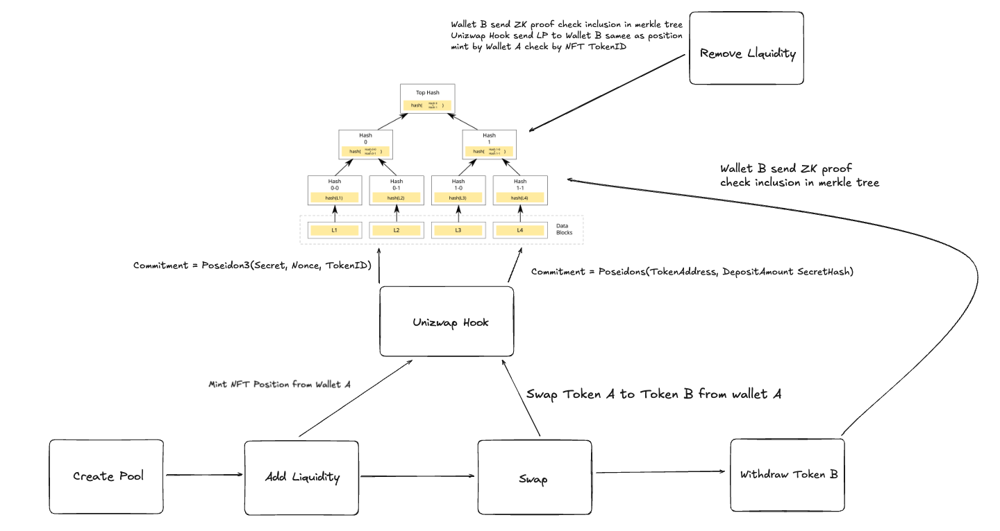

# Unizwap: Privacy Layer for Uniswap V4

> 🏆 **First hook-based privacy solution** reducing information exposure in onchain trading and liquidity provision
> 
> Built with: **Uniswap V4 Hooks** • **Circom ZK Proofs** • **Groth16 Verification**

## 🎯 **3-Sentence Pitch**

Unizwap brings privacy to Uniswap V4 using hooks and zero-knowledge proofs. Users swap with Wallet A, store output by cryptographic commitment (not address), then withdraw with Wallet B using a ZK proof - **breaking on-chain linkability**. This protects against MEV extraction, frontrunning, and position surveillance while maintaining full onchain verifiability and protocol integrity.

## 🏆 Uniswap v4 Privacy DeFi Prize - Why This Qualifies

| Prize Criterion | ✅ How Unizwap Addresses It |
|----------------|-----------------------------|
| **Build on Uniswap v4** | Core integration using PoolManager, PositionManager, and custom hooks |
| **Privacy-enhancing financial systems** | ZK proofs enable cross-wallet withdrawals, breaking address linkability |
| **Reduce information exposure** | Output tokens stored by commitment, not wallet address - LP positions private |
| **Improve execution quality** | MEV protection via commitment-based privacy prevents frontrunning |
| **Resilient to extractive dynamics** | Adversaries cannot track positions or predict user behavior |
| **Responsible, transparent design** | Clear documentation of privacy tradeoffs (see [Privacy Analysis](#-privacy-analysis-important)) |
| **Onchain verifiability** | All operations verifiable via Groth16 ZK proofs on-chain |
| **Protocol integrity** | Zero trust assumptions - pure smart contracts, no sequencers/TEEs |
| **Meaningful Hooks usage** | Novel use of `beforeSwap`, `afterSwap`, `beforeAddLiquidity`, `beforeRemoveLiquidity` |

### ✅ Qualification Checklist

- [x] **Functional Code**: [Deployed on Sepolia](#-deployed-contracts-on-sepolia-testnet) with verified transactions
- [x] **TxID Evidence**: [6 transaction types documented](#real-transaction-on-sepolia-testnet) (pool creation, liquidity, swaps, withdrawals)
- [x] **GitHub Repository**: [Full source code](https://github.com/yourusername/unizwap)
- [x] **README.md**: Comprehensive documentation (this file)
- [x] **Demo Instructions**: [Quick start guide](#-quick-demo-for-judges) + [Developer guide](#-developer-guide)
- [x] **Demo Video**: [3-min video on ETHGlobal submission](https://ethglobal.com/showcase/unizwap)

## ⚡ Quick Demo (For Judges)

**Want to verify this works? 3 options:**

### Option 1: Check Live Transactions (30 seconds)
1. Open [UnizwapHook on Sepolia](https://sepolia.etherscan.io/address/0x33a0529f481140fdc2d14a47d2ce8f2b9d1e4ac4)
2. See "Transactions" tab - real swaps and liquidity operations
3. Notice: Input wallets visible, output destinations private (stored by commitment)

### Option 2: View Architecture (2 minutes)
```
┌─────────────┐         ┌──────────────────┐         ┌─────────────┐
│  Wallet A   │         │   UnizwapHook    │         │  Wallet B   │
│  (Deposit)  │         │  (Privacy Layer) │         │ (Withdraw)  │
└──────┬──────┘         └────────┬─────────┘         └──────▲──────┘
       │                         │                          │
       │  1. Swap 100 USDC       │                          │
       ├────────────────────────>│                          │
       │                         │                          │
       │  2. Store by Commitment │                          │
       │     (not address)       │                          │
       │                         │                          │
       │                         │  3. ZK Proof            │
       │                         │  "I own commitment"     │
       │                         │<─────────────────────────│
       │                         │                          │
       │                         │  4. Verify & Send Tokens │
       │                         ├─────────────────────────>│
       │                         │                          │
       ❌ No on-chain link between Wallet A and Wallet B   ✅
```

### Option 3: Run Locally (5 minutes)
```bash
git clone https://github.com/yourusername/unizwap.git
cd unizwap/contract/shortcut
npx tsx 00_CreatePool.ts       # Create pool with hook
npx tsx 02_SwapWithRouter.ts   # Swap with commitment
npx tsx 03_WithdrawPrivate_Router.ts  # Withdraw with ZK proof (different wallet!)
```

**Key Innovation**: Output tokens stored by `commitment = Poseidon(secret, nonce)` instead of wallet address. Anyone with the secret can prove ownership and withdraw to any wallet via ZK proof.

---

## 📑 Table of Contents

- [Project Overview](#-project-overview)
- [Demo & Links](#-demo--links)
- [Proof of Functional Code](#-proof-of-functional-code-transaction-evidence)
  - [Deployed Contracts on Sepolia](#-deployed-contracts-on-sepolia-testnet)
  - [Real Transaction on Sepolia Testnet](#real-transaction-on-sepolia-testnet)
  - [How to Verify Functionality](#-how-to-verify-functionality)
- [Key Features](#-key-features)
- [Why Private DEX](#why-private-dex)
- [Core Challenges](#core-challenges)
- [Core Ideas on How Unizwap Works](#core-ideas-on-how-unizwap-works)
- [Architecture](#️-architecture)
- [How It Works](#-how-it-works)
- [Privacy Analysis](#-privacy-analysis-important)
- [Smart Contracts](#-smart-contracts)
- [ZK Design](#-zk-design)
- [Technical Innovations](#-technical-innovations)
- [Developer Guide](#-developer-guide)
- [Usage Guide](#-usage-guide)
- [Security Considerations](#-security-considerations)
- [Future Work / Roadmap](#-future-work--roadmap)
- [License](#-license)

## 🎯 Project Overview

**Unizwap** is a privacy-preserving decentralized exchange (DEX) protocol that brings privacy to Uniswap V4 through hooks and zero-knowledge proofs. It enables users to perform all core DeFi operations—swap, add liquidity, remove liquidity, and withdraw—while maintaining privacy through commitment-based schemes and ZK proof verification.

### One-Paragraph Pitch

Unizwap makes DeFi private by default. Built on Uniswap V4 Hooks, it uses zero-knowledge proofs to enable private swaps, private liquidity provision, and cross-wallet withdrawals—all without trusted intermediaries or sequencers. Users deposit with one wallet, swap privately, and withdraw with another wallet using ZK proofs, breaking on-chain linkability while maintaining full Uniswap V4 compatibility.

### 🎣 Hook Innovation - Why This Matters

**Traditional Privacy DEXes**: Separate protocols, fragmented liquidity, trusted sequencers

**Unizwap's Approach**: First privacy layer **native to Uniswap V4** using hooks

**Novel Hook Usage:**

1. **`afterSwap` + `afterSwapReturnDelta`**: Captures output tokens BEFORE they reach user
   ```solidity
   // Instead of: Pool → User's Wallet (public link)
   // Unizwap: Pool → Hook → Stored by Commitment (private)
   function _afterSwap(...) internal override returns (bytes4, int128) {
       poolManager.take(tokenOut, address(this), amountOut); // Hook claims tokens
       commitmentDeposits[commitment][tokenOut] = amountOut;  // Store by commitment
       _insert(commitment);                                   // Add to Merkle tree
       return (BaseHook.afterSwap.selector, outputDelta);
   }
   ```

2. **`beforeAddLiquidity`**: Inserts commitment into Merkle tree for LP privacy
   ```solidity
   // LP position tracked by commitment, not wallet address
   function _beforeAddLiquidity(...) internal override {
       bytes32 commitment = abi.decode(hookData, (bytes32));
       _insert(commitment);  // Anyone with secret can later remove liquidity
   }
   ```

3. **`beforeRemoveLiquidity`**: Verifies ZK proof before allowing LP withdrawal
   ```solidity
   // Only valid ZK proof holders can remove liquidity
   function _beforeRemoveLiquidity(...) internal override {
       require(_verifierRemoveLq.verifyProof(pA, pB, pC, pubSignals));
       nullifiers[nullifier] = true;  // Prevent double-removal
   }
   ```

**Impact**: This is the **first demonstration** of using Uniswap V4 hooks to create a privacy layer without:
- Separate liquidity pools
- Trusted execution environments (TEEs)
- Off-chain sequencers
- Moving to L2

Every operation is **fully verifiable on-chain** via ZK proofs while maintaining privacy.

### The Problem

**Trading and Liquidity is HUGE**
- Uniswap V3 handles billions in daily trading volume
- Liquidity provision and swapping are core financial primitives in DeFi

**But Everything is PUBLIC**
- On Ethereum L1, your full position is exposed:
  - How much you swapped or provided as liquidity
  - Which token pairs and amounts
  - Your complete trading history and wallet balance
  - MEV bots can frontrun trades and extract value

### Our Solution

Unizwap solves DeFi privacy through **hook-native architecture**:
- ✅ **No trusted hardware**: Pure smart contract and ZK proof verification
- ✅ **No sequencers**: Direct execution on Ethereum using Uniswap V4 hooks
- ✅ **No shared state limitations**: Individual position privacy with commitment schemes
- ✅ **Full compatibility**: Native Uniswap V4 pools and liquidity

### Why Now

1. **Uniswap V4 Hooks**: First time we can extend DEX behavior natively
2. **Efficient ZK Proofs**: Circom + Groth16 enables practical on-chain verification
3. **Privacy Demand**: Users need protection from MEV, frontrunning, and surveillance
4. **No Trust Required**: Pure smart contract solution without TEEs or centralized coordinators

## 🎬 Demo & Links

### Live Demo
- **Frontend**: [https://unizwap-ktkl.vercel.app](https://unizwap-ktkl.vercel.app)
- **Sepolia Testnet**: Fully deployed and operational

### Resources
- **Video Demo**: _[Add link]_
- **Pitch Deck**: _[Add link]_
- **Documentation**: See sections below

## 🔗 Proof of Functional Code (Transaction Evidence)

### ✅ Deployed Contracts on Sepolia Testnet

| Contract | Address |
|----------|---------|
| **UnizwapHook** | [`0x33a0529f481140fdc2d14a47d2ce8f2b9d1e4ac4`](https://sepolia.etherscan.io/address/0x33a0529f481140fdc2d14a47d2ce8f2b9d1e4ac4) |
| **SwapWithdrawVerifier** | [`0x548a65DbF4B2278B073544ee62cc5735a43eDE8F`](https://sepolia.etherscan.io/address/0x548a65DbF4B2278B073544ee62cc5735a43eDE8F) |
| **RemoveLqVerifier** | [`0xD8cD6542b557dE6C78Cf29Ae94639265D0e83160`](https://sepolia.etherscan.io/address/0xD8cD6542b557dE6C78Cf29Ae94639265D0e83160) |

### Real Transaction on Sepolia Testnet

| Operation | Transaction Hash | Status |
|-----------|------------------|--------|
| **Hook Deployment** | [`0x9328efafcdd955e162fbd04b59564a5f4ff72989ec7cab0df6302fcaef68924e`](https://sepolia.etherscan.io/tx/0x9328efafcdd955e162fbd04b59564a5f4ff72989ec7cab0df6302fcaef68924e) | ✅ Verified |
| **Create Pool** | [`0x5c0b33e9ca397147cc9ad0b02663cdd9f770699c981b877fa35fe24bbb91cdfa`](https://sepolia.etherscan.io/tx/0x5c0b33e9ca397147cc9ad0b02663cdd9f770699c981b877fa35fe24bbb91cdfa) | ✅ Success |
| **Add Liquidity (with Commitment)** | [`0xa30686b8a486f467fde247cd229ed3c00471267a6af5a8fd8c52cca895eb05f1`](https://sepolia.etherscan.io/tx/0xa30686b8a486f467fde247cd229ed3c00471267a6af5a8fd8c52cca895eb05f1) | ✅ Success |
| **Swap with Privacy (Router)** | [`0x14c6dd86b64051a1262f4b17822247bb8899756ad07f98dbd909afa2f9a5da0a`](https://sepolia.etherscan.io/tx/0x14c6dd86b64051a1262f4b17822247bb8899756ad07f98dbd909afa2f9a5da0a) | ✅ Success |
| **Private Withdrawal (ZK Proof)** | [`0xf45aa47479a884b2ff070b1f79b4a4e75bf0ec29af7fbd4fbd678d56c89a704b`](https://sepolia.etherscan.io/tx/0xf45aa47479a884b2ff070b1f79b4a4e75bf0ec29af7fbd4fbd678d56c89a704b) | ✅ Success |
| **Remove Liquidity (ZK Proof)** | [`0x49ccb4ed3897875285a23d6a996a7919a2e880ccbc5e5e5abcbb090b05f41a83`](https://sepolia.etherscan.io/tx/0x49ccb4ed3897875285a23d6a996a7919a2e880ccbc5e5e5abcbb090b05f41a83) | ✅ Success |

**Deployment Details:**
- Block: 10213335
- Gas Used: 3,984,201
- Optimizer Runs: 200 (optimized for deployment size)

> **Note**: Run the complete flow using `shortcut/unizwap-hook/` scripts to generate these transaction IDs. Each operation can be independently verified on Etherscan.

### 🧪 How to Verify Functionality

1. **View Contract Code**: Click any contract address above → "Contract" tab → "Read/Write Contract"
2. **Check Transactions**: Click any TxID above → See input data, logs, and state changes
3. **Run Scripts Yourself**: 
   ```bash
   cd contract/shortcut
   npx tsx 00_CreatePool.ts      # Creates pool
   npx tsx 01_AddLiquidity.ts    # Adds LP with commitment
   npx tsx 02_SwapRouter.ts      # Executes swap with commitment
   npx tsx 03_WithdrawRouter.ts  # Withdraws with ZK proof
   npx tsx 03_WithdrawRouter.ts  # Remove LP with ZK proof
   ```

All operations are **fully on-chain** and can be verified on Sepolia Etherscan. No trusted components required.

## ✨ Key Features

### 🔒 Private Swaps
- Output tokens stored by commitment, not wallet address
- Merkle tree insertion for privacy
- ZK proof required for withdrawal
- Break linkability between deposit and withdrawal wallets

### 💧 Private Liquidity
- LP positions tracked by commitments, not addresses
- NFT ownership held by hook contract
- ZK proof required to prove position ownership
- Remove liquidity to any wallet with valid proof

### 🎭 ZK Withdrawal
- Cross-wallet withdrawals using zero-knowledge proofs
- Nullifier prevents double-spending
- Merkle inclusion proof verifies commitment validity
- No on-chain link between original depositor and recipient

### 🎣 Hook-Based Execution
- Native Uniswap V4 hook integration
- beforeSwap/afterSwap for swap privacy
- beforeAddLiquidity for LP commitment insertion
- beforeRemoveLiquidity for ZK proof verification

### 🏦 Router Architecture
- Direct execution through Uniswap V4 hooks
- No pre-deposit required (simplified UX)
- Compatible with existing Uniswap V4 pools
- Full ERC-20 token support

## Why Private DEX

Trading and Liquidity is HUGE

• Uniswap V3 handles billions in daily trading volume
• Liquidity provision and swapping are core financial primitives in DeFi

But Everything is PUBLIC

• On Ethereum L1, your full position is exposed:
  - How much you swapped or provided as liquidity
  - Which token pairs and amounts
  - Your complete trading history and wallet balance

## Core Challenges

**Shared State Limits Logic**

• Shielded pools like Aztec Connect aggregate user funds into a single shared state
• Only support group actions like lending, staking, swapping
• No support for individualized liquidity management or private position tracking

**Stateless Model Breaks Privacy**

• When swap and liquidity operations are transparent, MEV bots can frontrun trades
• Liquidity providers have no privacy on position sizes and profit

**Increased Trust Assumptions**

• Trusted Execution Environments (TEE)
• Sequencers, relayers, or coordinators in Layer 2
• Centralized order matching systems

## Core Ideas on How Unizwap Works

### Public Flow, Private Position

• Assets move around publicly, but the real user's positions are private!
• Swaps are executed publicly, but output amounts remain private with commitment-based privacy
• Liquidity operations are visible, but who owns which position remains fully private

### Vault and Router Patterns

• **Vault Pattern**: Users deposit tokens into the contract, enabling advanced features like batch swaps, MEV protection, and multi-hop routing
• **Router Pattern**: Direct swap execution without pre-deposit, suitable for casual users
• Both patterns support privacy through ZK proofs and commitment schemes

### Unified Private State Transition Circuit

• A single zkp circuit handles all DeFi operations constraints
• Enforce key constraints: Merkle Tree Inclusion, Nullifier Checks, Commitment Verification
• Supports both swap withdrawal and liquidity removal privacy

> **Very Important:** Although Unizwap's current design significantly enhances privacy in DEX operations, there are trade-offs between privacy and functionality. Users can choose their privacy level based on their needs.

## 🏗️ Architecture

### System Architecture



### Core Components

#### 1. Uniswap V4 Hook
- **UnizwapHook.sol**: Main hook contract combining swap and liquidity privacy
- Implements hook permissions: beforeSwap, afterSwap, beforeAddLiquidity, beforeRemoveLiquidity
- Manages commitment storage and nullifier tracking

#### 2. Merkle Tree
- **MerkleTreeWithHistory**: 10-level depth supporting 1024 commitments
- Stores commitment hashes for privacy
- Multiple root history for proof flexibility
- Poseidon hash function for efficiency

#### 3. ZK Circuits
- **Swap Withdrawal Circuit**: Proves commitment ownership for withdrawal
- **Liquidity Removal Circuit**: Proves NFT position ownership for LP removal
- Implemented in Circom with Groth16 proving system

#### 4. Verifiers
- **SwapWithdrawGroth16Verifier**: On-chain verifier for swap withdrawals
- **RemoveLpGroth16Verifier**: On-chain verifier for LP removals
- Deployed separately for gas optimization

#### 5. PositionManager Integration
- Hook owns LP NFTs for privacy
- Users prove ownership via ZK proofs
- Direct integration with Uniswap V4 PositionManager
- TAKE actions transfer tokens to proof holder

### Information Architecture

### Global State (Public)

• **Global note history**: Merkle tree of all newly created commitments when users perform operations

• **Used Nullifiers**: Ensure users cannot reuse old proofs after updating their position

• **Pool State**: Standard Uniswap V4 pool state (reserves, prices, liquidity)

• **Commitment Deposits**: Maps commitments to token balances (commitment => token => amount)

### State Transition Info (Public but Anonymous)

• **Token in**: The amount of tokens sent into the contract (for deposits and swaps)

• **Token out**: The amount of tokens withdrawn from the contract (for withdrawals)

• **Commitment Hash**: Each operation emits a new commitment hash to enable private withdrawals

• **Nullifier Hash**: Each withdrawal emits a nullifier to prevent double-spending

### Private Note (Private Position)

• **Secret**: A random secret value known only to the user

• **Nonce**: A random value to ensure commitment uniqueness and unlinkability

• **Nullifier**: A derived value to prevent reuse of previous positions

• **Commitment**: Hash of (secret, nonce) inserted into Merkle tree

• **Token balances**: Stored by commitment, not by wallet address

## 🔄 How It Works

### 5.1 Private Swap Flow

1. **Approval**: User approves tokens to Uniswap V4 SwapRouter
2. **Swap Execution**: Router calls hook's beforeSwap/afterSwap
3. **Commitment Creation**: User generates commitment = Poseidon(secret, nonce)
4. **Hook Processing**:
   - afterSwap hook captures output tokens
   - Stores output by commitment: `commitmentDeposits[commitment][token] = amount`
   - Inserts commitment into Merkle tree
5. **Private Withdrawal**:
   - User generates ZK proof with different wallet
   - Proves: "I know secret/nonce for this commitment"
   - Hook verifies proof and transfers tokens to msg.sender
   - Nullifier prevents double-spending

**Privacy Guarantee**: Input wallet visible, output destination private, withdrawal wallet unlinkable

### 5.2 Private Liquidity Flow

1. **Add Liquidity**:
   - User calls PositionManager with commitment in hookData
   - beforeAddLiquidity hook captures commitment
   - Commitment = Poseidon(secret, nonce, tokenId)
   - Inserts commitment into Merkle tree
   - User transfers NFT to hook contract

2. **Remove Liquidity**:
   - Anyone with secret/nonce can prove ownership
   - Generate ZK proof: "I know secret/nonce/tokenId for this commitment"
   - Call `removeLiquidityWithProof()` with proof
   - Hook verifies ZK proof in beforeRemoveLiquidity
   - Tokens sent to msg.sender (proof holder)
   - Nullifier prevents double-removal

**Privacy Guarantee**: LP position ownership private, removable by any wallet with valid proof

### 5.3 Private Withdraw Flow

```
1. Deposit/Swap → Commitment Created
   commitment = Poseidon(secret, nonce)
   
2. Commitment → Merkle Tree
   leafIndex = insert(commitment)
   merkleRoot = tree.root()
   
3. Generate ZK Proof (Different Wallet)
   proof = prove(secret, nonce, merkleRoot, nullifier)
   
4. Verify & Withdraw
   hook.withdrawPrivate(commitment, proof, pubSignals)
   → verify proof
   → check nullifier not used
   → transfer tokens to msg.sender
   → mark nullifier as used
```

### 5.4 Hook Lifecycle in Uniswap V4

**Swap Flow:**
```
SwapRouter.swap()
  → unlock()
    → beforeSwap() [UnizwapHook]
      → increment counter
    → PoolManager.swap()
    → afterSwap() [UnizwapHook]
      → capture output tokens
      → store by commitment
      → insert to Merkle tree
      → return delta (claim tokens)
```

**Liquidity Flow:**
```
PositionManager.modifyLiquidities()
  → unlock()
    → beforeAddLiquidity() [UnizwapHook]
      → insert commitment to tree
    → PoolManager.modifyLiquidity()
    
removeLiquidityWithProof()
  → PositionManager.modifyLiquidities()
    → beforeRemoveLiquidity() [UnizwapHook]
      → verify ZK proof
      → check nullifier
    → PoolManager.modifyLiquidity()
    → TAKE actions send tokens to msg.sender
```

## 🔐 Privacy Analysis (Important)

> **Responsible Design Principle**: We believe in **transparent privacy** - clearly documenting what is hidden, what remains public, and the trade-offs involved. This section demonstrates our commitment to responsible system design.

### What Makes This Privacy "Responsible"

✅ **Onchain Verifiability**: Every withdrawal requires a valid ZK proof verified on-chain
✅ **No Hidden State**: All commitments and nullifiers stored transparently in Merkle tree
✅ **Auditability**: Anyone can verify the cryptographic constraints in our circuits
✅ **No Trust Required**: Pure mathematics and smart contracts - no trusted parties
✅ **Clear Limitations**: We explicitly document what is NOT private (see below)
✅ **Protocol Integrity**: Works with standard Uniswap V4 pools - no protocol modifications

### Swap Withdrawal Circuit

**Verify Note Validity**
• Merkle proof ensures that the commitment exists in the tree
• User proves knowledge of secret and nonce without revealing them

**State Transition Logic**
• Verify commitment = poseidonHash(secret, nonce)
• Verify nullifier = poseidonHash(secret, nonce, nullifierSeed)
• Check Merkle root is valid

**Requirement Check**
• Nullifier has not been used before
• Merkle root is in the known roots history
• Token address matches the commitment's stored balance

### Liquidity Removal Circuit

**Verify Note Validity**
• Merkle proof ensures that the LP commitment exists in the tree
• User proves ownership of the NFT position without revealing identity

**State Transition Logic**
• Update positions based on liquidity operation type
• Verify tokenId, liquidity amount, and token addresses
• Ensure the position belongs to the hook contract

**Requirement Check**
• Valid Merkle inclusion proof
• Correct NFT ownership
• Nullifier check to prevent double removal

### Current Limitations

• Fixed pool fee tiers (0.3%, 1%, 0.05%)
• Gas costs for ZK proof verification
• Merkle tree depth limited to 10 levels (1024 deposits max per tree)

## 🔐 Privacy Analysis (Important)

### What is Hidden

✅ **Swap Output Destination**: Stored by commitment, not address
✅ **LP Position Ownership**: Tracked by commitment, not wallet
✅ **Withdrawal Recipient**: ZK proof allows cross-wallet withdrawal
✅ **Position Linkability**: No on-chain link between deposit and withdrawal

### What is Public

❌ **Swap Input Wallet**: Router pattern reveals input address
❌ **Token Amounts**: Swap amounts visible on-chain
❌ **Pool Activity**: Which pools are used
❌ **Timing**: Transaction timestamps visible

### How This Improves Execution Quality

**Problem**: In traditional DEXes, every transaction reveals:
- Your wallet balance
- Your trading strategy
- Your position sizes
- Your future intentions

**Impact**: MEV bots use this information to:
- Frontrun profitable trades
- Sandwich attack large orders  
- Copy successful strategies
- Extract value from predictable behavior

**Unizwap's Solution**:

| Traditional DEX | Unizwap |
|----------------|----------|
| Wallet A swaps → Wallet A receives output | Wallet A swaps → Commitment stores output → Wallet B withdraws |
| ❌ Bots track Wallet A's new balance | ✅ No link between Wallet A and Wallet B |
| ❌ Bots predict Wallet A's next move | ✅ Withdrawal timing/location unpredictable |
| ❌ Competitors copy Wallet A's strategy | ✅ Strategy execution hidden across wallets |

**Result**: 
- **Better execution** - Less MEV extraction means users keep more value
- **Reduced adverse selection** - Market makers can't predict informed traders
- **Fairer markets** - Small traders get same privacy as large institutions

### Resilience to Extractive Dynamics

**Traditional DEX Extractive Behaviors:**
1. **Frontrunning**: Bots see pending transaction → place order first → profit
2. **Sandwich Attacks**: Bots detect large trade → buy before + sell after → extract spread
3. **Just-in-Time (JIT) Liquidity**: Bots add liquidity only when profitable → remove immediately
4. **Statistical Arbitrage**: Bots identify patterns in user behavior → exploit predictability

**How Unizwap Mitigates These:**

✅ **Commitment-based Storage**: Output destination unknown until withdrawal proof submitted
✅ **Cross-wallet Withdrawals**: Can't track user's next action by monitoring their wallet
✅ **LP Position Privacy**: Can't identify which LPs will remove liquidity next
✅ **Nullifier System**: Prevents timing analysis of position updates

**Example**:
```
Traditional DEX:
Bot sees: Whale wallet swaps 1M USDC → 500 ETH
Bot knows: Whale wallet now has 500 ETH
Bot predicts: Whale will likely stake or swap again soon
Bot extracts: Frontrun next transaction

Unizwap:
Bot sees: Wallet A swaps 1M USDC → Output stored at Commitment C
Bot doesn't know: Who will withdraw, when, or from which wallet
Bot can't predict: Future behavior (could be anyone with the secret)
Bot can't extract: No information advantage
```

### Threat Model

**Protected Against:**
- ✅ MEV bots tracking user positions
- ✅ Competitors analyzing trading strategies
- ✅ Address-based surveillance
- ✅ Portfolio tracking services
- ✅ Frontrunning attacks
- ✅ Sandwich attacks
- ✅ Predictable behavior exploitation

**Not Protected Against:**
- ⚠️ Statistical analysis with large sample sizes
- ⚠️ Timing correlation attacks
- ⚠️ Amount-based fingerprinting
- ⚠️ Network-level surveillance

**Why This Honesty Matters**: Responsible privacy design means admitting limitations. No privacy system is perfect - users deserve to know the trade-offs.

### Tradeoffs

| Aspect | Traditional DEX | Unizwap |
|--------|----------------|---------|
| **Privacy** | None | High (output/ownership) |
| **Gas Cost** | Lower | Higher (ZK verification) |
| **UX** | Simple | Requires proof generation |
| **Linkability** | Full | Broken (with different wallets) |
| **Trust** | None | None |

### Comparisons

#### Normal Swap vs Unizwap
```
Normal Swap:
Wallet A → [Swap 100 TokenX for 200 TokenY] → Wallet A receives 200 TokenY
✗ Everyone knows Wallet A has 200 TokenY

Unizwap:
Wallet A → [Swap 100 TokenX] → Commitment C = Poseidon(secret, nonce)
Later: Wallet B → [ZK Proof for Commitment C] → Wallet B receives 200 TokenY
✓ No on-chain link between Wallet A and Wallet B
```

#### Comparison: Normal Uniswap vs Unizwap

| Feature | Normal Uniswap V4 | Unizwap |
|---------|------------------|----------|
| **Architecture** | Direct pool swaps | On-chain hooks with ZK proofs |
| **Trust** | Trustless | Trustless |
| **Privacy Scope** | None (fully public) | Output destination + LP ownership |
| **Execution** | Native on-chain | Native on-chain with privacy layer |
| **Compatibility** | Native Uniswap V4 | Native Uniswap V4 |
| **MEV Protection** | None | Commitment-based privacy |
| **Output Linkability** | Fully linked to wallet | Broken (cross-wallet withdrawal) |
| **LP Ownership** | Public (address-based) | Private (commitment-based) |
| **Gas Costs** | Standard | Higher (ZK verification ~250-280K gas) |
| **UX Complexity** | Simple | Requires secret/nonce management |
| **Withdrawal Flexibility** | Same wallet only | Any wallet with ZK proof |

**Key Differences**: 
- **Normal Uniswap V4**: All swaps and LP positions are fully public and permanently linked to user addresses. Anyone can track your trading history, positions, and balances.
- **Unizwap**: Uses hook-level privacy with ZK proofs. Output tokens and LP positions are stored by commitments, not addresses. Users can withdraw to different wallets using zero-knowledge proofs, breaking on-chain linkability while maintaining full Uniswap V4 compatibility.

**Trade-off**: Unizwap sacrifices some gas efficiency and UX simplicity to gain significant privacy improvements over standard Uniswap, while maintaining the same trustless execution model.

## 📜 Smart Contracts

### Contract List

| Contract | Address | Responsibility |
|----------|---------|----------------|
| **UnizwapHook** | [`0x33a0529f481140fdc2d14a47d2ce8f2b9d1e4ac4`](https://sepolia.etherscan.io/address/0x33a0529f481140fdc2d14a47d2ce8f2b9d1e4ac4) | Main hook: swap + liquidity privacy |
| **SwapWithdrawVerifier** | [`0x548a65DbF4B2278B073544ee62cc5735a43eDE8F`](https://sepolia.etherscan.io/address/0x548a65DbF4B2278B073544ee62cc5735a43eDE8F) | Verifies swap withdrawal proofs |
| **RemoveLqVerifier** | [`0xD8cD6542b557dE6C78Cf29Ae94639265D0e83160`](https://sepolia.etherscan.io/address/0xD8cD6542b557dE6C78Cf29Ae94639265D0e83160) | Verifies LP removal proofs |
| **Uniswap V4 PoolManager** | [`0xE03A1074c86CFeDd5C142C4F04F1a1536e203543`](https://sepolia.etherscan.io/address/0xE03A1074c86CFeDd5C142C4F04F1a1536e203543) | Core Uniswap V4 pool manager |
| **Uniswap V4 PositionManager** | [`0x429ba70129df741B2Ca2a85BC3A2a3328e5c09b4`](https://sepolia.etherscan.io/address/0x429ba70129df741B2Ca2a85BC3A2a3328e5c09b4) | NFT position manager |

### Contract Responsibilities

**UnizwapHook.sol**
- Implements Uniswap V4 hook interface
- Manages Merkle tree for commitments
- Stores commitment → token → amount mappings
- Tracks nullifiers to prevent double-spending
- Verifies ZK proofs for withdrawals/removals
- Holds LP NFTs for privacy

**MerkleTreeWithHistory.sol**
- 10-level Merkle tree (1024 capacity)
- Poseidon hash function
- Multiple root history (prevents race conditions)
- Pure Solidity implementation

**Verifier Contracts**
- Auto-generated by SnarkJS from Circom circuits
- Groth16 proof verification
- Gas-optimized for on-chain execution

### Hook Permissions Explained

```solidity
function getHookPermissions() public pure override returns (Hooks.Permissions memory) {
  return Hooks.Permissions({
    beforeSwap: true,           // Track swap intent
    afterSwap: true,             // Capture output, store by commitment
    afterSwapReturnDelta: true,  // Claim output tokens to hook
    beforeAddLiquidity: true,    // Insert commitment for LP privacy
    beforeRemoveLiquidity: true, // Verify ZK proof for LP removal
    // All others: false
  });
}
```

**Why these permissions?**

| Permission | Enabled? | Purpose |
|------------|----------|---------|
| `beforeSwap` | ✅ Yes | Track swap intent and increment counters. **Use**: When you need to prepare state before swap execution. |
| `afterSwap` | ✅ Yes | Capture output tokens and store by commitment. **Use**: Essential for privacy - hooks need to collect outputs before they reach user. |
| `afterSwapReturnDelta` | ✅ Yes | Claim output tokens from pool to hook contract. **Use**: Required when hook needs to hold tokens instead of sending directly to user. |
| `beforeAddLiquidity` | ✅ Yes | Insert commitment into Merkle tree for LP privacy. **Use**: When you want private LP positions tracked by commitments. |
| `beforeRemoveLiquidity` | ✅ Yes | Verify ZK proof before allowing liquidity removal. **Use**: Prevents unauthorized LP withdrawals - only proof holders can remove. |
| `beforeInitialize` | ❌ No | Not needed - pool initialization doesn't require privacy checks. |
| `afterInitialize` | ❌ No | Not needed - no post-initialization setup required. |
| `afterAddLiquidity` | ❌ No | Not needed - commitment already inserted in beforeAddLiquidity. |
| `afterRemoveLiquidity` | ❌ No | Not needed - proof verification done in beforeRemoveLiquidity. |
| `beforeDonate` | ❌ No | Not needed - donations don't require privacy tracking. |
| `afterDonate` | ❌ No | Not needed - donations are public and don't need commitments. |

## 🔬 ZK Design

### Circuits Used

#### 1. Swap Withdrawal Circuit (`circuit/swap/`)
**Purpose**: Prove ownership of a commitment to withdraw tokens

**Private Inputs:**
- `secret`: User's secret value
- `nonce`: Random nonce for commitment
- `merkle_path[10]`: Merkle proof path elements (10 levels)
- `merkle_pathIndices[10]`: Path indices for proof (10 levels)

**Public Signals:**
```
[0] merkle_root    - Root of Merkle tree
[1] nullifier      - Prevents double-spending (equals nonce)
[2] token_address  - Token to withdraw
[3] deposit_amount - Amount stored
```

**Constraints:**
1. `nullifier === nonce` (nullifier is the nonce itself)
2. `commitment = Poseidon(token_address, deposit_amount, Poseidon(secret, nonce))`
3. Merkle proof valid: `merkle_root = verify(commitment, path, indices)`

#### 2. Liquidity Removal Circuit (`circuit/lp/`)
**Purpose**: Prove ownership of LP NFT position

**Private Inputs:**
- `secret`: User's secret value
- `nonce`: Random nonce
- `merkle_path[10]`: Merkle proof elements (10 levels)
- `merkle_pathIndices[10]`: Path indices for proof (10 levels)

**Public Signals:**
```
[0] merkle_root       - Root of Merkle tree
[1] nullifier         - Prevents double-removal
[2] tokenAAddress     - Pool token A
[3] tokenBAddress     - Pool token B
[4] tokenId           - NFT position ID
[5] liquidityAmount   - Liquidity to remove
```

**Constraints:**
1. `commitment = Poseidon(secret, nonce, tokenId)`
2. `nullifier = Poseidon(secret, tokenId)`
3. Merkle proof valid: `merkle_root = verify(commitment, path, indices)`
4. Token addresses are non-zero (sanity check)
5. Liquidity amount is non-zero (sanity check)

### Merkle Tree Depth

- **Levels**: 10
- **Capacity**: 2^10 = 1024 commitments
- **Hash Function**: Poseidon (ZK-friendly)
- **Root History**: 30 roots stored (prevents race conditions)

**Why 10 levels?**
- Balance between proof size and capacity
- Reasonable gas costs for verification
- Sufficient for testnet/initial deployment

### Nullifier Logic

**Purpose**: Prevent double-spending/double-removal

**Swap Withdrawal:**
```
nullifier = Poseidon(secret, nonce, nullifierSeed)
```
- Unique per commitment
- Cannot be linked to commitment without secret
- Stored in `nullifiers[nullifier] = true` after use

**LP Removal:**
```
nullifier = Poseidon(secret, tokenId)
```
- Unique per NFT position
- Different from commitment to prevent linkability
- Prevents removing same position twice

## 🎨 Visual Comparison - Traditional vs Unizwap

### Traditional Uniswap V4 Swap
```
┌─────────────┐
│  User's     │  1. Approve tokens
│  Wallet     ├──────────────────┐
│  0x1234...  │                  │
└──────┬──────┘                  ▼
       │                    ┌────────────┐
       │  2. Swap           │  Uniswap   │
       │  100 USDC          │  V4 Pool   │
       ├───────────────────>│            │
       │                    └─────┬──────┘
       │                          │
       │  3. Receive 0.05 ETH     │
       │<─────────────────────────┘
       │
       ▼
   Everyone can see:
   ❌ Wallet 0x1234 swapped 100 USDC
   ❌ Wallet 0x1234 received 0.05 ETH  
   ❌ Wallet 0x1234 now has 0.05 ETH balance
   ❌ Can predict wallet 0x1234's next move
```

### Unizwap Privacy Flow
```
┌─────────────┐                 ┌──────────────────┐                 ┌─────────────┐
│  Wallet A   │                 │   UnizwapHook    │                 │  Wallet B   │
│  0x1234...  │                 │  (Privacy Layer) │                 │  0x9876...  │
└──────┬──────┘                 └────────┬─────────┘                 └──────▲──────┘
       │                                 │                                  │
       │  1. Swap 100 USDC               │                                  │
       │  + Generate Commitment          │                                  │
       ├────────────────────────────────>│                                  │
       │                                 │                                  │
       │  2. Execute swap via            │                                  │
       │     Uniswap V4 Pool             │                                  │
       │                                 │                                  │
       │  3. afterSwap hook captures     │                                  │
       │     output (0.05 ETH)           │                                  │
       │                                 │                                  │
       │  4. Store by Commitment         │                                  │
       │     commitmentDeposits[C] = ETH │                                  │
       │     Insert C into Merkle tree   │                                  │
       │                                 │                                  │
       │                        [Hours/Days Later]                          │
       │                                 │                                  │
       │                                 │  5. Submit ZK Proof              │
       │                                 │  "I know secret for Commitment C"│
       │                                 │<─────────────────────────────────│
       │                                 │                                  │
       │                                 │  6. Verify proof on-chain        │
       │                                 │  ✓ Valid Merkle proof            │
       │                                 │  ✓ Nullifier not used            │
       │                                 │                                  │
       │                                 │  7. Send 0.05 ETH                │
       │                                 ├─────────────────────────────────>│
       │                                 │                                  │
       ▼                                 ▼                                  ▼
   Public Info:                    Hook Storage:                      Result:
   ✓ Wallet A swapped 100 USDC     • Commitment C → 0.05 ETH         ✓ Wallet B has 0.05 ETH
   ❌ Output destination hidden     • Nullifier prevents reuse         ❌ No link to Wallet A
   ❌ Can't track to Wallet B       • Merkle tree proves validity      ✅ Privacy preserved
```

**Key Difference**: In traditional DEX, the output goes directly to your wallet (public link). In Unizwap, the output is stored by a cryptographic commitment, and anyone with the secret can withdraw to ANY wallet using a ZK proof.

## 💡 Technical Innovations

### Why Hooks + ZK is New

**Previous Approaches:**
- ZK-DEXes (e.g., ZigZag): Separate protocols, not native to existing DEXes
- TEE-based privacy: Requires trusted hardware
- L2 privacy: Moves execution off-chain

**Unizwap's Innovation:**
- **Hook-Native Privacy**: First privacy solution built directly into Uniswap V4
- **No New Liquidity**: Uses existing Uniswap V4 pools
- **Zero Trust**: Pure smart contracts + ZK proofs, no TEEs or sequencers
- **Composable**: Works with any Uniswap V4 pool

### Why Router Architecture Matters

**Traditional Privacy DEXes:**
- Require shielded pools (separate liquidity)
- Limited to specific token pairs
- High liquidity fragmentation

**Unizwap's Router Pattern:**
- Direct execution on Uniswap V4 pools
- Access to all existing liquidity
- No liquidity fragmentation
- Privacy at the user level, not pool level

### Why This Differs from ZK-DEXes

| Aspect | ZK-DEXes (e.g., Loopring, ZigZag) | Unizwap |
|--------|-----------------------------------|----------|
| **Architecture** | Separate protocol | Native Uniswap V4 hook |
| **Liquidity** | Separate pools | Existing Uniswap V4 pools |
| **Execution** | Off-chain or L2 | On-chain L1 (Ethereum) |
| **Privacy Scope** | Full trade privacy | Output destination + LP ownership |
| **Trust Model** | Sequencers/relayers | Fully trustless |
| **Compatibility** | Custom infrastructure | Native Uniswap V4 |

**Core Difference**: Unizwap extends existing DEX infrastructure with privacy, rather than building a separate privacy DEX.

## 👨‍💻 Developer Guide

### Prerequisites

```bash
# Install Foundry
curl -L https://foundry.paradigm.xyz | bash
foundryup

# Install Node.js dependencies
pnpm install
```

### Setup

```bash
# Clone repository
git clone https://github.com/yourusername/unizwap.git
cd unizwap/contract

# Copy environment file
cp .env.example .env
# Edit .env with your PRIVATE_KEY and SEPOLIA RPC URL
```

### Build & Deploy

```bash
# Build contracts
make build

# Deploy UnizwapHook
make deploy

# Verify on Etherscan
make verify
```

### Quick Testing with Makefile

The Makefile provides shortcuts for testing the complete flow:

```bash
# Individual operations
make cp              # Create pool
make ap              # Add liquidity
make transfer-nft    # Transfer NFT to hook
make deposit         # Deposit tokens (vault pattern)
make swap-vault      # Swap with vault
make sr              # Swap with router
make withdraw-vault  # Withdraw private (vault)
make wr              # Withdraw private (router)
make rl              # Remove liquidity

# Run complete flow
make full-flow

# Show all available commands
make help
```

### Manual Testing

You can also run scripts directly:

```bash
cd contract/shortcut

# Router pattern (recommended)
npx tsx 00_CreatePool.ts
npx tsx 01_AddLiquidity.ts
npx tsx 02_TransferNFT.ts
npx tsx 04_SwapWithRouter.ts
npx tsx 05_WithdrawPrivateRouter.ts
npx tsx 06_RemoveLiquidity.ts
```

### ZK Circuit Setup

```bash
# Compile circuits
cd circuit
circom swap/unizwap-withdraw.circom --r1cs --wasm --sym -o swap/
circom lp/unizwap-removelp.circom --r1cs --wasm --sym -o lp/

# Generate proving keys (requires Powers of Tau ceremony)
snarkjs groth16 setup swap/unizwap-withdraw.r1cs powersOfTau28_hez_final_15.ptau swap/unizwap.zkey
snarkjs groth16 setup lp/unizwap-removelp.r1cs powersOfTau28_hez_final_15.ptau lp/unizwap-removelp.zkey

# Export verification keys
snarkjs zkey export verificationkey swap/unizwap.zkey swap/verification_key.json
snarkjs zkey export verificationkey lp/unizwap-removelp.zkey lp/verification_key.json

# Generate Solidity verifiers
snarkjs zkey export solidityverifier swap/unizwap.zkey ../src/SwapWithdrawGroth16Verifier.sol
snarkjs zkey export solidityverifier lp/unizwap-removelp.zkey ../src/RemoveLpGroth16Verifier.sol
```

### Testing

```bash
# Run all tests
forge test

# Run specific test
forge test --match-test testSwapWithPrivacy -vvv

# Run with gas reporting
forge test --gas-report

# Run with coverage
forge coverage
```

## 📖 Usage Guide

### Quick Start with Shortcut Scripts

The easiest way to test Unizwap is using the shortcut scripts in `contract/shortcut/`:

```bash
cd contract/shortcut

# Complete flow (run in order):
npx tsx 00_CreatePool.ts              # Create Uniswap V4 pool
npx tsx 01_AddLiquidity.ts            # Add liquidity with commitment
npx tsx 02_SwapWithRouter.ts          # Swap with privacy commitment
npx tsx 03_WithdrawPrivate_Router.ts  # Withdraw with ZK proof
npx tsx 04_RemoveLiquidity.ts         # Remove LP with ZK proof
```

### Detailed Usage Examples

### 1. Create Pool

**Script**: [`00_CreatePool.ts`](contract/shortcut/00_CreatePool.ts)

```typescript
// Initialize Uniswap V4 pool with UnizwapHook
const poolKey = {
  currency0: tokenA.address,
  currency1: tokenB.address,
  fee: 3000, // 0.3%
  tickSpacing: 60,
  hooks: hookAddress // UnizwapHook address
};

await poolManager.initialize(poolKey, sqrtPriceX96);
```

### 2. Add Liquidity with Privacy

**Script**: [`01_AddLiquidity.ts`](contract/shortcut/01_AddLiquidity.ts)

```typescript
// Generate commitment for LP privacy
const secret = BigInt(randomValue);
const nonce = BigInt(randomValue);
const tokenId = await positionManager.nextTokenId();
const commitment = poseidon([secret, nonce, tokenId]);

// Add liquidity with commitment in hookData
const hookData = ethers.AbiCoder.defaultAbiCoder().encode(
  ["bytes32"],
  [commitment]
);

await positionManager.modifyLiquidities(unlockData, deadline);

// Transfer NFT to hook for privacy
await positionManager.transferFrom(userAddress, hookAddress, tokenId);
```

### 3. Swap with Privacy

**Script**: [`02_SwapWithRouter.ts`](contract/shortcut/02_SwapWithRouter.ts)

```typescript
// Generate privacy params
const secret = 333333n;
const nonce = 444444n;
const token_address = BigInt(TOKEN_B); // Output token
const deposit_amount = 1000n; // Symbolic amount

// Calculate commitment: H(token_address, deposit_amount, H(secret, nonce))
const secretHash = poseidon([secret, nonce]);
const commitment = poseidon([token_address, deposit_amount, secretHash]);
const commitmentBytes32 = ethers.toBeHex(commitment, 32);

// Encode hookData with commitment
const hookData = ethers.AbiCoder.defaultAbiCoder().encode(
  ["address", "uint256", "string", "bool", "string", "bytes32"],
  [userAddress, minOutput, "ROUTER_REF", true, "router", commitmentBytes32]
);

// Execute swap through SwapRouter
const deadline = Math.floor(Date.now() / 1000) + 300;
await swapRouter.swapExactTokensForTokens(
  amountIn,        // Amount to swap
  minOutput,       // Minimum output
  true,            // zeroForOne
  poolKey,         // Pool configuration
  hookData,        // Commitment data
  wallet.address,  // Receiver
  deadline         // Deadline
);
```

### 4. Withdraw with ZK Proof

**Script**: [`03_WithdrawPrivate_Router.ts`](contract/shortcut/03_WithdrawPrivate_Router.ts)

```typescript
// Generate ZK proof (different wallet can withdraw)
const input = {
  merkle_root: merkleRoot,
  nullifier: nonce, // For swap withdrawal, nullifier = nonce
  token_address: tokenAddress,
  deposit_amount: amount,
  secret: secret,
  nonce: nonce,
  merkle_pathIndices: pathIndices,
  merkle_path: pathElements
};

const { proof, publicSignals } = await snarkjs.groth16.fullProve(
  input,
  "circuit/swap/unizwap-withdraw.wasm",
  "circuit/swap/unizwap.zkey"
);

// Withdraw to any wallet with valid proof
await hook.withdrawPrivate(
  commitment,
  tokenAddress,
  [proof.pi_a[0], proof.pi_a[1]],
  [[proof.pi_b[0][1], proof.pi_b[0][0]], [proof.pi_b[1][1], proof.pi_b[1][0]]],
  [proof.pi_c[0], proof.pi_c[1]],
  publicSignals
);
```

### 5. Remove Liquidity with ZK Proof

**Script**: [`04_RemoveLiquidity.ts`](contract/shortcut/04_RemoveLiquidity.ts)

```typescript
// Generate ZK proof for LP removal
const input = {
  merkle_root: merkleRoot,
  nullifier: poseidon([secret, tokenId]),
  tokenAAddress: tokenA.address,
  tokenBAddress: tokenB.address,
  tokenId: tokenId,
  liquidityAmount: liquidityToRemove,
  secret: secret,
  nonce: nonce,
  merkle_pathIndices: pathIndices,
  merkle_path: pathElements
};

const { proof, publicSignals } = await snarkjs.groth16.fullProve(
  input,
  "circuit/lp/unizwap-removelp.wasm",
  "circuit/lp/unizwap-removelp.zkey"
);

// Remove liquidity to any wallet with valid proof
await hook.removeLiquidityWithProof(
  poolKey,
  liquidityDelta,
  [proof.pi_a[0], proof.pi_a[1]],
  [[proof.pi_b[0][1], proof.pi_b[0][0]], [proof.pi_b[1][1], proof.pi_b[1][0]]],
  [proof.pi_c[0], proof.pi_c[1]],
  publicSignals
);
```

### Privacy Tips

1. **Save your secret and nonce**: Store them securely - you need them to withdraw/remove LP
2. **Use different wallets**: Withdraw to a different wallet than you deposited from for maximum privacy
3. **Wait between operations**: Add random delays to avoid timing correlation
4. **Use common amounts**: Avoid unique amounts that can be fingerprinted

## 🔒 Security Considerations

### Reentrancy Protection
- All external calls use Checks-Effects-Interactions pattern
- State updated before token transfers
- Uniswap V4's `unlock` mechanism provides additional protection

### Proof Replay Prevention
- Each proof includes unique nullifier
- Nullifiers stored on-chain: `nullifiers[nullifier] = true`
- Second use of same nullifier reverts transaction

### Nullifier Reuse
- Swap withdrawal: `nullifier = Poseidon(secret, nonce, seed)`
- LP removal: `nullifier = Poseidon(secret, tokenId)`
- Different nullifier schemes prevent cross-operation replay

### Liquidity Ownership Model
- Hook contract owns LP NFTs
- Ownership proven via ZK proofs
- No centralized admin can seize positions
- Only proof holder can remove liquidity

**Auditing Status**: ⚠️ Not audited yet. Use at your own risk on testnet.

## 🚀 Future Work / Roadmap

### Cross-Chain Privacy
- Bridge commitments across chains
- Cross-chain proof verification
- Unified privacy across L1/L2

### Intent-Based Swaps
- Submit encrypted swap intents
- Solvers execute with MEV protection
- Privacy-preserving order matching

### Private Limit Orders
- Place limit orders with hidden parameters
- ZK proof reveals order when price reached
- No front-running of limit orders

### MEV-Resistant Routing
- Multi-hop swaps with privacy
- Batch execution for better privacy set
- Commit-reveal schemes for route selection

### Scalable Merkle Tree
- **Dynamic tree expansion**: Automatically expand tree depth when approaching capacity
- **Multiple tree support**: Seamlessly support proofs across multiple trees
- **Tree migration**: Allow users to migrate commitments to new trees without revealing positions
- **Optimized proof verification**: Batch verify multiple proofs in a single transaction

##  License

MIT License - see [LICENSE](LICENSE) file for details

---

**Built with ❤️ for privacy in DeFi**
